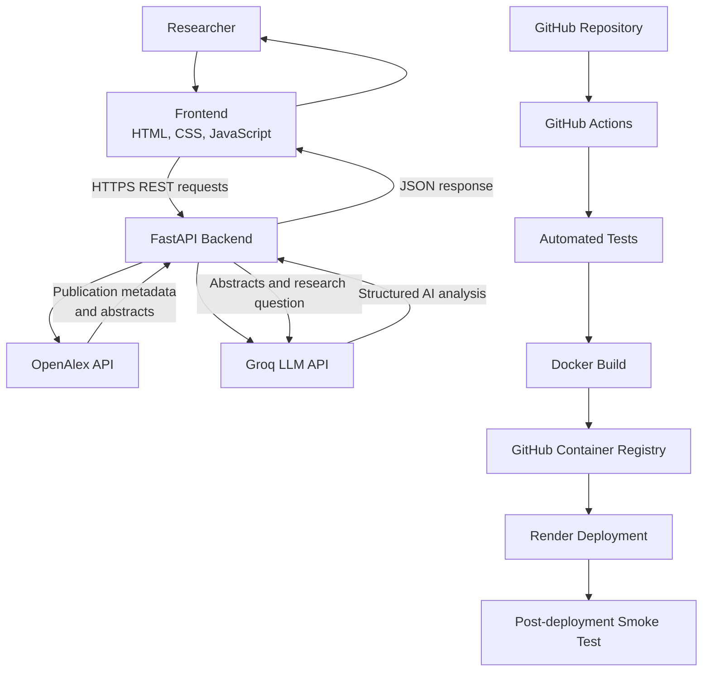
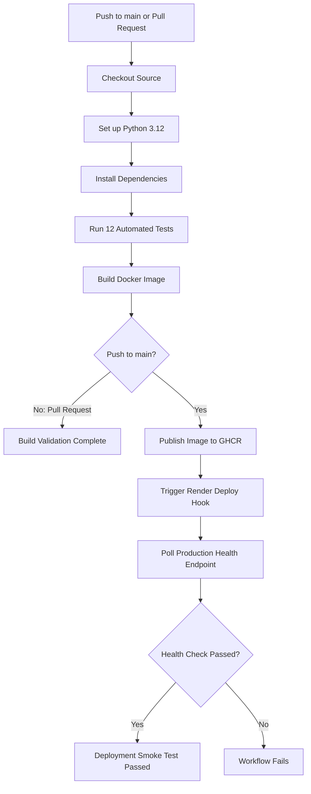

# BioLit Scout 🔬
### AI-Assisted Scientific Literature Discovery and Analysis

[](https://github.com/katia0610/biolit-scout/actions/workflows/ci.yml)

**BioLit Scout** is a scientific literature discovery and analysis application that combines [OpenAlex](https://openalex.org/) for academic publication retrieval with [Groq](https://groq.com/) for AI-powered analysis. It helps researchers explore scientific publications, understand research methods and findings, compare studies, and identify potential research directions.

Version **0.3.0** provides a deployed FastAPI backend, a responsive web interface, automated testing, Docker image publishing, and continuous deployment.

## 🚀 Live Demo

| Component | URL |
|---|---|
| Web interface | [BioLit Scout Frontend](https://biolit-scout.netlify.app/) |
| REST API | [Render API](https://biolit-scout.onrender.com) |
| API health check | [Health Endpoint](https://biolit-scout.onrender.com/health) |
| Interactive API documentation | [Swagger UI](https://biolit-scout.onrender.com/docs) |
| Source code | [GitHub Repository](https://github.com/katia0610/biolit-scout) |


## ✨ Features

### 1. Scientific Publication Discovery

BioLit Scout uses the OpenAlex API to retrieve scientific publications matching a research question.

- Search by scientific topic, keywords, or research question.
- Retrieve publication titles, authors, publication years, DOI links, journals, and available abstracts.
- Reconstruct abstracts from OpenAlex's inverted-index representation.
- Configure the number of publications returned by the search.

### 2. AI-Powered Article Analysis

The application uses a Groq-hosted language model to analyze the available abstracts of retrieved publications.

For each analyzed publication, the system generates:

- **Research objective:** the main question or goal of the study.
- **Methodology:** the methods described in the abstract.
- **Main findings:** the reported results.
- **Limitations:** limitations explicitly stated in the abstract, when available.
- **Relevance:** the relationship between the publication and the user's research question.

The analysis is grounded in the metadata and abstracts supplied to the model. Access to the complete text of a publication is not assumed.

### 3. Comparative Scientific Synthesis

BioLit Scout generates a comparative synthesis across the analyzed publications. It can highlight differences in research approaches, methodologies, reported findings, and study scope.

### 4. Potential Research Directions

The application proposes research directions suggested by the selected publications. These suggestions are exploratory hypotheses rather than verified gaps in the entire scientific literature.

### 5. Interactive Web Interface

The frontend is a standalone HTML, CSS, and JavaScript application deployed on Netlify.

It includes:

- A research question form and publication-count selector.
- A live API connection status indicator.
- Publication cards with metadata and original publication links.
- Expandable or collapsible abstracts.
- Individual AI-generated analyses.
- A comparative synthesis panel.
- A research directions panel.
- Summary statistics for retrieved publications, analyzed abstracts, and suggested directions.
- JSON report copying and session-based search history.
- Responsive layouts for desktop and mobile devices.

### 6. Automated CI/CD

GitHub Actions automates the software delivery process, from testing code changes to publishing a Docker image and deploying the backend to Render.

## 🏗️ Architecture



### Main components

| Component | Responsibility |
|---|---|
| Netlify | Hosts the static frontend |
| FastAPI | Exposes REST endpoints and coordinates the analysis workflow |
| OpenAlex | Retrieves scientific publications and available abstracts |
| Groq | Generates structured article analyses and comparative synthesis |
| Docker | Packages the backend and its dependencies |
| GitHub Actions | Automates testing, image publishing, and deployment |
| GitHub Container Registry (GHCR) | Stores published Docker images |
| Render | Hosts the deployed API |

## 🛠️ Technology Stack

- **Language:** Python 3.12
- **Backend:** FastAPI
- **Frontend:** HTML5, CSS3, JavaScript
- **Publication discovery:** OpenAlex API
- **Language model inference:** Groq API
- **HTTP client:** HTTPX
- **Data validation:** Pydantic
- **Testing:** Pytest, FastAPI TestClient
- **Containerization:** Docker
- **CI/CD:** GitHub Actions
- **Container registry:** GitHub Container Registry
- **Backend hosting:** Render
- **Frontend hosting:** Netlify

## 📁 Project Structure

```text
biolit-scout/
├── app/
│   ├── main.py
│   └── services/
│       ├── openalex.py
│       └── groq_analysis.py
├── env/
├── frontend/
│   └── index.html
├── tests/
│   └── test_main.py
├── .github/
│   └── workflows/
│       └── ci.yml
├── .env
├── .gitignore
├── .dockerignore
├── Dockerfile
├── requirements.txt
└── README.md
```

The standalone frontend is maintained as an `index.html` file and deployed separately to Netlify.

## ⚙️ Installation and Local Development

### Prerequisites

- Python 3.12
- Git
- An OpenAlex API key
- A Groq API key

### 1. Clone the repository

```bash
git clone https://github.com/katia0610/biolit-scout.git
cd biolit-scout
```

### 2. Create a virtual environment

**Windows PowerShell**

```powershell
python -m venv env
.\env\Scripts\Activate.ps1
```

**Linux or macOS**

```bash
python3 -m venv env
source env/bin/activate
```

### 3. Install dependencies

```bash
python -m pip install --upgrade pip
pip install -r requirements.txt
```

### 4. Configure environment variables

Create a `.env` file in the project root:

```dotenv
OPENALEX_API_KEY="your_openalex_api_key"
GROQ_API_KEY="your_groq_api_key"
GROQ_MODEL="openai/gpt-oss-20b"
```

Replace the example values with your own credentials and configure a Groq-supported model.

**Security:** Never commit `.env` or expose API keys in frontend JavaScript. The frontend communicates with the backend, which accesses the external APIs using server-side environment variables.

### 5. Run the API

```bash
uvicorn app.main:app --reload
```

The local API is available at:

- API root: `http://127.0.0.1:8000/`
- Health check: `http://127.0.0.1:8000/health`
- Swagger documentation: `http://127.0.0.1:8000/docs`

### 6. Run the frontend locally

Open `index.html` in a browser or serve the frontend through a local static server. Ensure the backend CORS configuration permits the frontend origin.

The deployed frontend uses the Render API URL. For local development, update the frontend API base URL to `http://127.0.0.1:8000`.

## 🔌 REST API

### `GET /health`

Checks the availability of the API.

Example response:

```json
{
  "status": "ok",
  "service": "BioLit Scout",
  "version": "0.3.0"
}
```

### `GET /`

Returns the service welcome message, version, and available endpoints.

### `GET /search`

Searches scientific publications through OpenAlex.

**Query parameters**

| Parameter | Type | Constraints |
|---|---|---|
| `q` | String | Required, 2–300 characters |
| `limit` | Integer | Optional, 1–10; default: 5 |

Example:

```bash
curl -G "https://biolit-scout.onrender.com/search" \
  --data-urlencode "q=cell segmentation microscopy" \
  --data-urlencode "limit=5"
```

The endpoint returns the matching publications and their available metadata and abstracts.

### `POST /analyze`

Searches for publications and analyzes those with available abstracts.

**Request body**

```json
{
  "q": "deep learning for cell segmentation in microscopy images",
  "limit": 3
}
```

The `q` field is required and accepts 2–300 characters. The optional `limit` field accepts values from 1 to 5 and defaults to 5.

Example response structure:

```json
{
  "query": "deep learning for cell segmentation in microscopy images",
  "searched_count": 3,
  "analyzed_count": 3,
  "publications": [
    {
      "id": "https://openalex.org/W123",
      "title": "Example scientific publication",
      "year": 2025,
      "authors": ["Author Name"],
      "abstract": "Available publication abstract...",
      "journal": "Example Journal",
      "doi": "https://doi.org/example",
      "url": "https://example.org/article",
      "analysis": {
        "id": "https://openalex.org/W123",
        "objective": "Research objective...",
        "methodology": "Methodology described in the abstract...",
        "main_findings": "Reported findings...",
        "limitations": "Limitations stated in the abstract...",
        "relevance_to_query": "Relevance to the research question..."
      }
    }
  ],
  "comparative_synthesis": "Comparison of the analyzed publications...",
  "research_gaps": [
    "Potential research direction..."
  ],
  "message": "Analysis is based on available abstracts, not necessarily full-text articles."
}
```

The example illustrates the response structure; publication data and generated analyses depend on the actual API results.

## 🔄 CI/CD Pipeline

BioLit Scout uses GitHub Actions to automate testing, container image publishing, and backend deployment.

Workflow configuration: `.github/workflows/ci.yml`

### Workflow triggers

The pipeline runs on:

- **Push to `main`:** tests, Docker image build and publication, Render deployment, and a post-deployment health check.
- **Pull requests targeting `main`:** automated tests and Docker image build without publishing the image or deploying the backend.

### Pipeline stages

#### 1. Source checkout

GitHub Actions checks out the repository source code using `actions/checkout`.

#### 2. Python environment setup

The workflow configures Python 3.12 using `actions/setup-python` and installs the dependencies declared in `requirements.txt`.

#### 3. Automated testing

The workflow executes:

```bash
python -m pytest -v
```

The test suite validates the API endpoints, request validation, abstract reconstruction, publication analysis behavior, and error handling using mocked external API responses where appropriate.

The current test suite contains **12 automated tests**.

#### 4. Docker image build

The workflow configures Docker Buildx and builds the backend image using the repository's `Dockerfile`.

This checks that the application can be packaged into a container with its required dependencies.

#### 5. Docker image publication to GHCR

On pushes to `main`, GitHub Actions authenticates to GitHub Container Registry and publishes two image tags:

```text
ghcr.io/katia0610/biolit-scout:latest
ghcr.io/katia0610/biolit-scout:<commit-sha>
```

The `latest` tag identifies the most recently published image, while the commit SHA tag identifies the image built from a specific source revision.

The workflow uses the built-in `GITHUB_TOKEN` with the necessary `packages: write` permission.

#### 6. Automated Render deployment

After publishing the image, the workflow triggers the configured Render deployment hook using the GitHub Actions secret:

```text
RENDER_DEPLOY_HOOK_URL
```

The deployment hook URL is stored as a secret rather than hard-coded into the repository.

#### 7. Post-deployment smoke test

After triggering the deployment, the workflow checks the production health endpoint:

```text
https://biolit-scout.onrender.com/health
```

It waits 30 seconds initially, then retries the health check up to 30 times with a 10-second interval. If the API becomes healthy, the smoke test passes; otherwise, the job fails.

This provides an automated check that the deployed service responds after the deployment is triggered.

### CI/CD flow



### Required GitHub Actions secret

Configure the following secret under:

**GitHub Repository → Settings → Secrets and variables → Actions**

| Secret | Purpose |
|---|---|
| `RENDER_DEPLOY_HOOK_URL` | Triggers the Render deployment |

The workflow uses GitHub's automatically provided `GITHUB_TOKEN` for GHCR authentication. No separate GHCR password is required by this workflow.

### Required Render environment variables

Configure the application environment in the Render service dashboard:

| Variable | Purpose |
|---|---|
| `OPENALEX_API_KEY` | Authenticates OpenAlex requests |
| `GROQ_API_KEY` | Authenticates Groq inference requests |
| `GROQ_MODEL` | Selects the configured Groq model |
| `NETLIFY_ORIGIN` | Allows the deployed frontend origin through the backend CORS policy |

Keep all credentials and deployment hooks out of source control.

### Deployment verification

After a successful workflow run, verify:

- [Production health endpoint](https://biolit-scout.onrender.com/health)
- [Swagger API documentation](https://biolit-scout.onrender.com/docs)
- The frontend deployed on Netlify
- A real `POST /analyze` request through the frontend

**Note:** the smoke test validates API health, not the full correctness of an OpenAlex search or Groq analysis. Those integrations should also be verified with an end-to-end request.

## 🧪 Testing

Run the automated test suite locally:

```bash
python -m pytest -v
```

Tests cover:

- Health and root endpoints.
- Successful publication search.
- Search parameter validation.
- Analysis request validation.
- Publications with missing abstracts.
- Abstract reconstruction.
- Successful Groq analysis with mocked responses.
- Missing Groq API key handling.

External API calls are mocked in unit tests where appropriate, allowing the test suite to run without consuming API credits or relying on external service availability.

## 🔐 Security and Reliability

- API credentials are stored in server-side environment variables.
- `.env` is excluded from source control.
- The frontend does not contain OpenAlex or Groq credentials.
- CORS is configured to permit the intended frontend origin.
- Request timeouts and HTTP errors from external services are handled by the backend.
- AI-generated findings are based on available abstracts and should be checked against the original publications.
- Research directions are exploratory and require further literature review.
- DOI and publication links allow users to inspect the underlying sources.

## 🗺️ Roadmap

Potential future developments include:

- Agentic research workflows with controlled tool selection.
- Iterative query reformulation and follow-up literature searches.
- Improved relevance ranking and duplicate or publication-type filtering.
- Evidence-linked comparative analyses.
- More comprehensive evaluation of scientific synthesis quality.
- Additional scholarly data sources and richer publication metadata.


---

**BioLit Scout 0.3** — Connecting scientific publications to meaningful research insights.
